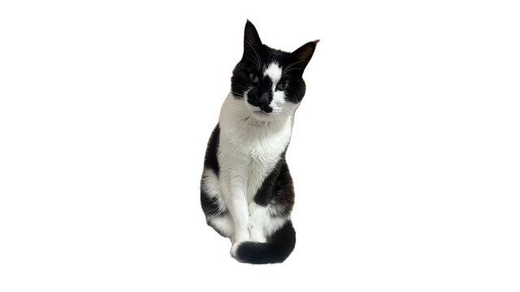

# 黑侠 · DeepSeek Harness 宠物

本定制基于 [PC2005-cloud/dsh-pet](https://github.com/PC2005-cloud/dsh-pet) 0.4.5（基线 `60bb2eb4113eca92b2636ab906f8e6c9c934ae13`），沿用其插件加载、动作切换、拖拽、右键菜单、会话状态联动、聊天与余额接口。没有使用本地喵伴项目。



黑侠是一只黑白短毛猫。宠物素材来自真实照片和视频，经本机前景分割形成透明 VP9 WebM；保留不对称脸纹、白胸、白爪和黑尾，不生成新的身体动作。两个照片来源用于待机和香箱工作，另有六个自然视频动作；取景、输入哈希与处理参数见 [素材清单](pet/media_manifest.json)。

## 已配置行为

- 宠物名“黑侠”，显示在 Harness 页面右下方；可拖拽、点击回应、右键点播与切换睡觉。
- 八个动作：待机、思考、工作、等你、庆祝、困困、回应、巡视。真实会话的思考、工具调用、工具结果、等待、成功和错误映射到对应动作。
- **自动聊天已开启**：默认每 300 秒一句，使用黑侠人设，跟随 Harness 当前模型。余额每 1800 秒刷新；上游在启动时立即查一次。语音与点击音效默认关闭。
- **余额查询已开启**：保留上游 DeepSeek 等已支持通道；若已安装 `model-quota` 插件，桥接其已配置服务商的查询结果。不同账户、币种和套餐窗口分别展示，不合并或拿 Token 用量估算账户余额。服务商不支持、未登录或查询失败时保留明确状态。
- 黑侠包强制保持实拍方向，包括手动菜单、API 指令及 Q 弹恢复；其他宠物保留上游镜像行为。固定位置关闭随机翻向与走位，仍可主动拖拽。

## 本地准备与安装

需要 Python 3、Node.js 24，以及已初始化的 DeepSeek Harness。播放已经制作好的宠物包无需 Swift 或 FFmpeg。

```sh
git clone https://github.com/zhangmin510/dsh-pet.git
cd dsh-pet
python3 -B heixia/scripts/prepare_runtime.py --install-deps
node heixia/scripts/verify-pack.mjs heixia/runtime heixia/pet
node heixia/scripts/install-pack.mjs --plugin-dir heixia/runtime --home ~/.dsh
```

准备脚本从 npm 获取固定 `dsh-pet@0.4.5`，核验 SHA-512 后只应用已记录的黑侠镜像补丁与余额桥接，不运行上游发布前的构建脚本；构建后的目录为 `heixia/runtime`。如已下载发布 tarball，可传 `--tarball /path/dsh-pet-0.4.5.tgz`。输出目录已存在时脚本拒绝覆盖，可用 `--output` 指定新目录。

桌面应用运行时，可在 **插件管理**中安装上述 `heixia/runtime` 的绝对路径。使用命令行安装则先完全退出桌面应用，再运行：

```sh
dsh plugin --profile desktop add link:/absolute/path/to/dsh-pet/heixia/runtime
```

重开 Harness，在设置的“桌宠配置”中查看黑侠。浏览器版使用 `--profile web`，随后 `dsh web`。本地链接目录应保留。安装宠物数据只写所选 `DSH_HOME/dsh-pet/pet/heixia-*`，替换前会备份；其他宠物与宿主模型设置不改动。首次配置隐藏内置蓝鱼，只显示黑侠；已有用户自定义主宠物偏好继续生效。

要在系统桌面显示，可在上游设置中把黑侠“显示位置”改成桌面或两者；上游此模式可能需要另外准备 Electron Helper，本定制默认使用 Harness 内浮层。

## 验证

```sh
node --test heixia/tests/pack.test.mjs heixia/tests/quota-bridge.test.mjs
python3 -B heixia/customization/apply_mirror_patch.py --runtime heixia/runtime --check
node --test heixia/customization/test_mirror_patch.mjs
```

配置验证调用真正的上游 Host 合并与客户端投影函数，拒绝默默回退成蓝鱼配置；安装前检查所有引用素材存在。镜像回归执行发布包的浏览器与桌面播放路径。代码测试、完整媒体解码和实际 Harness 界面检查的范围在交付记录中分别标明，不把源码单元测试当作真实模型或所有服务商的成功查询。

## 素材与限制

仅公开定制所需的透明派生素材与制作说明；不包含原始照片/视频、宿主凭据、聊天记录或用户配置。原件保持完整。头脸、脚爪、毛发边缘受实拍清晰度与本机分割精度限制，自然视频首尾可能有跳变。照片来源是静态姿态，不冒称新拍动作或骨骼动画。

上游代码继续采用 [MIT](../LICENSE)；黑侠派生媒体仅供本仓库的个人宠物演示与定制使用，不以代码 MIT 许可转授原始宠物照片或视频权利。
