# 黑侠 · DeepSeek Harness 宠物

本定制基于 [PC2005-cloud/dsh-pet](https://github.com/PC2005-cloud/dsh-pet) 0.4.5（基线 `60bb2eb4113eca92b2636ab906f8e6c9c934ae13`），沿用其插件加载、动作切换、拖拽、右键菜单、会话状态联动、聊天与余额接口。没有使用本地喵伴项目。


黑侠是一只黑白短毛猫。宠物素材来自真实照片和视频，经本机前景分割形成透明 VP9 WebM；保留不对称脸纹、白胸、白爪和黑尾，不生成新的身体动作。实拍动作和静态姿态保留真实脸纹。拖拽专用「拎起」按黑侠照片合成，随指针移动。取景、帧序、输入哈希与处理参数见 [动作计划](motion_plan.json) 和 [素材清单](pet/media_manifest.json)。

## 已配置行为

- 插件图标使用紧贴黑侠头脸的方形头像，去掉整身画布的大面积留白；浅色底衬让黑白脸纹在深色界面中也清楚可辨。
- 宠物名“黑侠”，显示在 Harness 页面右下方；可拖拽、点击回应、右键点播与切换睡觉。
- 共 18 种动作与姿态，六种会话状态各有自己的动作。
- **自动聊天已开启**：默认每 300 秒一句，使用黑侠人设，跟随 Harness 当前模型。余额每 1800 秒刷新；上游在启动时立即查一次。语音与点击音效默认关闭。
- **余额查询已开启**：保留上游 DeepSeek 等已支持通道；若已安装 `model-quota` 插件，桥接其已配置服务商的查询结果。不同账户、币种和套餐窗口分别展示，不合并或拿 Token 用量估算账户余额。服务商不支持、未登录或查询失败时保留明确状态。
- 黑侠包强制保持实拍方向，包括手动菜单、API 指令及 Q 弹恢复；其他宠物保留上游镜像行为。固定位置关闭随机翻向与走位，仍可主动拖拽。

## 场景与动作

待机、思考、工作、看结果、警觉和回头共用同一实拍机位与前爪落点。睡眠三段使用同一侧卧机位。巡视和翻身按原方向完整播一次，持续状态只用相近首尾或可回程的小动作。不同实拍机位用短淡入淡出衔接，开启系统减少动态效果时直接切换。

| 场景 | 动作 |
| --- | --- |
| 待机、固定观察、手动巡视 | 待机、回头、巡视 |
| 会话思考、工具运行、工具结果 | 思考、工作、看结果 |
| 等待审批、任务完成、任务报错 | 等你、庆祝、警觉 |
| 点击、拖拽、松手 | 回应、拎起、回到当前会话动作或待机 |
| 碎碎念和对话表现 | 回头、轻摆尾巴 |
| 入睡、睡着、醒来 | 入睡 → 困困 → 醒来 |
| 余额用量从最低到耗尽的 6 档 | 回应、洗脸、轻摆尾巴、回头、仰躺揣爪、困困 |
| 右键手动点播 | 日常、观察、回应、探索、梳洗、放松、静态和守候 |

余额档位使用服务商返回的用量比例。没有比例时按宿主行为显示气泡。固定模式下巡视由右键点播，抛掷、落地与碰撞沿用宿主物理反馈。

## 支持的动作与姿态

黑侠 1.2.0 包含 18 个动作与姿态。13 个实拍动作用 GIF 预览，5 个静态姿态用 PNG，其中「拎起」来自 GPT 图片合成。 表格会重复播放 GIF，插件和本地预览中的单次动作播完即停。

| 预览 | 动作 | 播放方式 | 表现 |
| --- | --- | --- | --- |
| 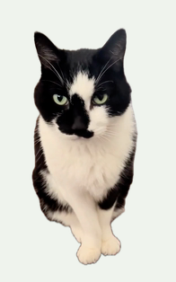 | 待机 | 实拍静态 | 同机位端坐，抬眼后安静守候。 |
| 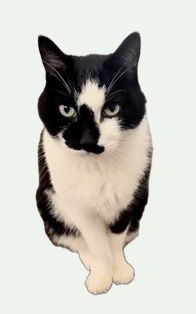 | 思考 | 实拍循环 | 从待机原姿态垂眼思索，再轻抬眼回正。 |
| 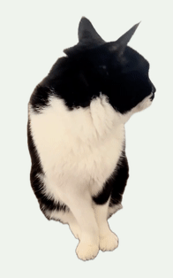 | 工作 | 实拍循环 | 端坐看向一侧，轻微动耳，陪伴任务运行。 |
| 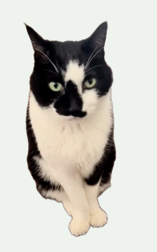 | 看结果 | 实拍静态 | 回正后专注地望向前方。 |
| 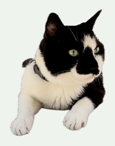 | 等你 | 实拍循环 | 趴卧时小幅抬眼，选相似首尾帧自然回环。 |
| 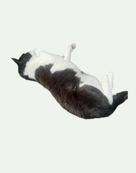 | 庆祝 | 实拍单次 | 低伏侧倒，连续翻身收爪，再仰卧停稳。 |
| 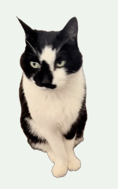 | 警觉 | 实拍单次 | 耳朵竖起，向另一侧转头，作为报错提醒。 |
| 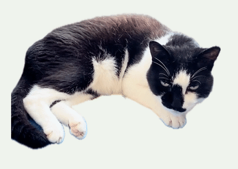 | 入睡 | 实拍单次 | 从清醒的侧卧放低头，接到睡眠循环。 |
| 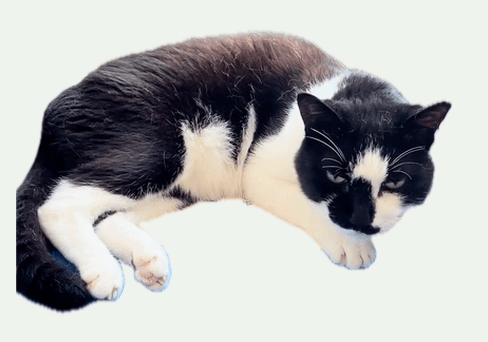 | 困困 | 实拍循环 | 把下巴放在爪边，保留实拍中轻微的呼吸和耳部变化。 |
| 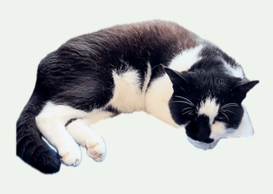 | 醒来 | 实拍单次 | 舔一下嘴唇，略抬起头。 |
| 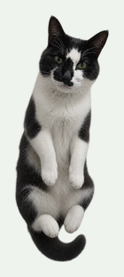 | 拎起 | GPT 合成姿态 | 前爪自然垂下，随指针移动。黑侠参考照的 GPT 合成姿态。 |
| 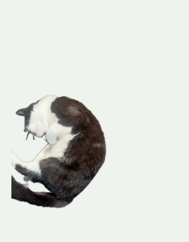 | 回应 | 实拍单次 | 侧卧舒展前爪和身体，用于点击回应。 |
| 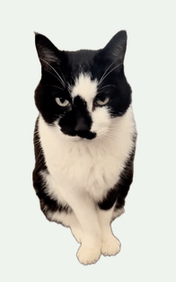 | 回头 | 实拍单次 | 端坐向右看一会，再转回正面。 |
| 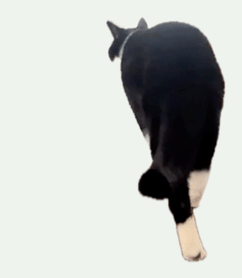 | 巡视 | 实拍单次 | 背向镜头向门口走几步。 |
| 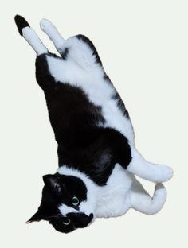 | 仰躺揣爪 | 实拍静态 | 仰躺露腹，双前爪自然弯曲。 |
| 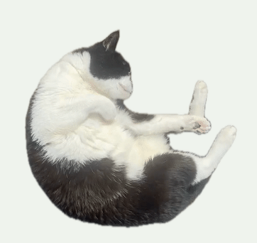 | 洗脸 | 实拍单次 | 抬白前爪擦过脸颊。 |
| 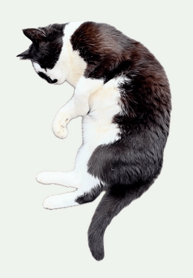 | 轻摆尾巴 | 实拍循环 | 侧卧时尾尖小幅弯摆。 |
| 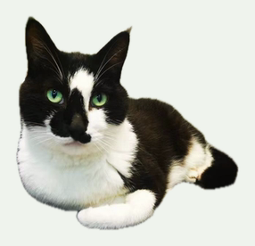 | 香箱 | 实拍静态 | 实拍香箱卧姿，双前爪收拢。 |

[打开动作预览页文件](preview.html) 时请保留同目录的 pet 素材。

## 安装黑侠

先[下载黑侠 1.2.0 安装包](https://github.com/zhangmin510/dsh-heixia-pet/releases/download/heixia-v1.2.0/dsh-heixia-pet-1.2.0.tgz)。保留下载的 `.tgz` 文件，Harness 会安装其中的预构建插件。[DeepSeek Harness 官方打包与安装文档](https://github.com/deepseek-ai/deepseek-harness/blob/master/docs/user/develop/basic/publish.zh.md)

### 桌面版

打开 **插件 → 添加插件**，粘贴下载文件的绝对路径并安装。安装后启用插件，并按应用提示重新加载。黑侠默认出现在 Harness 右下角。[官方插件管理器说明](https://github.com/deepseek-ai/deepseek-harness/blob/master/packages/client/ui-plugin-manager/README.zh.md)

### 浏览器版

在下载文件所在的目录运行以下命令。

```sh
dsh plugin --profile web add ./dsh-heixia-pet-1.2.0.tgz
dsh web
```

安装包包含全部 18 个动作与姿态。黑侠与原版沿用同一个 `dsh-pet` 插件标识，一个 profile 只能安装其中一个。桌面版已有原版时，先在插件页移除原版，再安装黑侠。插件继续读取已有的自定义宠物配置。若曾手动安装旧版黑侠配置或动作目录，安装前先备份并移出该配置与素材，才会看到新版内置动作。

### dsh-market

市场条目获目录收录后，可在 dsh-market 的插件市场页搜索「黑侠」并选择安装。[dsh-market](https://github.com/dsh-market/dsh-market)

## 从源码准备开发运行包

需要 Python 3、Node.js 24，以及已初始化的 DeepSeek Harness。播放已经制作好的宠物包无需 Swift 或 FFmpeg。

```sh
git clone https://github.com/zhangmin510/dsh-heixia-pet.git
cd dsh-heixia-pet
python3 -B heixia/scripts/prepare_runtime.py --install-deps
node heixia/scripts/verify-pack.mjs heixia/runtime heixia/pet
node heixia/scripts/install-pack.mjs --plugin-dir heixia/runtime --home ~/.dsh
```

准备脚本从 npm 获取固定 `dsh-pet@0.4.5`，核验 SHA-512 后应用黑侠的镜像、切换过渡与余额桥接，不运行上游发布前的构建脚本；构建后的目录为 `heixia/runtime`。如已下载发布 tarball，可传 `--tarball /path/dsh-pet-0.4.5.tgz`。输出目录已存在时脚本拒绝覆盖，可用 `--output` 指定新目录。

桌面应用请使用 **Plugins → Add plugin**，填入上述 `heixia/runtime` 的绝对路径并安装；成功后按应用提示重新加载，再在“桌宠配置”中查看黑侠。实测 Desktop 0.2.1-rc.5 的 `desktop` profile 由 Electron 应用独占管理，普通 npm 全局 CLI 会直接拒绝该 profile，退出应用也不会解除这项保护；不要手改 profile 或设置内部标记绕过。

浏览器版可用 `dsh plugin --profile web add link:/absolute/path/to/dsh-pet/heixia/runtime --ignore-scripts --workspace-root`，随后 `dsh web`。本地链接目录应保留。安装宠物数据只写所选 `DSH_HOME/dsh-pet/pet/heixia-*`，替换前会备份；其他宠物与宿主模型设置不改动。首次配置隐藏内置蓝鱼，只显示黑侠；已有用户自定义主宠物偏好继续生效。

要在系统桌面显示，可在上游设置中把黑侠“显示位置”改成桌面或两者；上游此模式可能需要另外准备 Electron Helper，本定制默认使用 Harness 内浮层。

维护者可运行 `python3 -B heixia/scripts/build_release.py --output /path/to/release` 生成安装包和 SHA-256 校验文件。已有固定版本的上游 npm 包时可传入 `--tarball /path/to/dsh-pet-0.4.5.tgz`。

## 验证

```sh
node --test heixia/tests/pack.test.mjs heixia/tests/quota-bridge.test.mjs
node --test heixia/customization/test_mirror_patch.mjs heixia/customization/test_motion_transition.mjs
```

透明 WebM 使用 libvpx-vp9 逐帧解码，持续循环的首尾帧差与段内相邻帧差一起校验。每个动作和姿态都用同一份最终媒体生成预览。

配置验证调用真正的上游 Host 合并与客户端投影函数，拒绝默默回退成蓝鱼配置；安装前检查所有引用素材存在。镜像回归执行发布包的浏览器与桌面播放路径。代码测试、完整媒体解码和实际 Harness 界面检查的范围在交付记录中分别标明，不把源码单元测试当作真实模型或所有服务商的成功查询。

## 素材与限制

仅公开定制所需的透明派生素材与制作说明；不包含原始照片/视频、宿主凭据、聊天记录或用户配置。原件保持完整。头脸、脚爪、毛发边缘受实拍清晰度与本机分割精度限制，自然视频首尾可能有跳变。照片与抽取的静态帧保留原姿态。「拎起」是 GPT 合成静态图，运动来自指针拖拽。没有实拍从坐姿到侧卧的完整衔接，跨机位换姿态用短过渡处理。

上游代码继续采用 [MIT](../LICENSE)；黑侠派生媒体仅供本仓库的个人宠物演示与定制使用，不以代码 MIT 许可转授原始宠物照片或视频权利。
